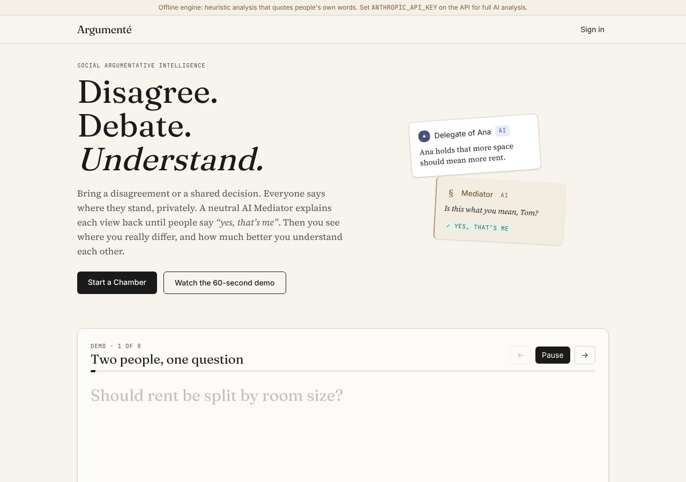
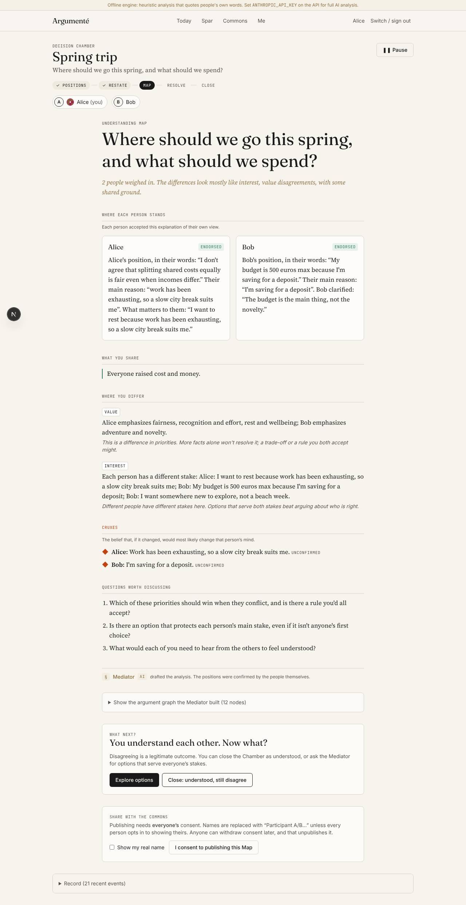

# Argumenté

> **Disagree. Debate. Understand.**

Human-owned AI **Delegates** plus a neutral **Mediator** that helps people understand each other before anyone tries to resolve anything.

## Run it locally

Prerequisites: [uv](https://docs.astral.sh/uv/) (Python 3.11+) and Node.js 20.9+.

```bash
./scripts/dev.sh --seed     # first run: installs deps, seeds demo data, starts both servers
./scripts/dev.sh            # later runs
```

- App: http://localhost:3000
- API docs (OpenAPI): http://localhost:8000/docs

**No API keys needed.** Without a key, the Mediator uses an offline heuristic engine that quotes people's own words. To switch to Claude, create `services/api/.env`:

```bash
ANTHROPIC_API_KEY=sk-ant-...
# optional overrides
# ENGINE_ANALYZE_MODEL=claude-sonnet-5-5
# ENGINE_FAST_MODEL=claude-haiku-5-5
```

Then restart. If a Claude call fails (bad key, network, refusal), that step falls back to the offline engine and the Chamber tells you.

### Or with Docker (Postgres, production build)

```bash
docker compose up --build        # http://localhost:3000 · API on :8000 · Postgres in a volume
```

Put `ANTHROPIC_API_KEY=...` in a `.env` file next to `docker-compose.yml` to use Claude. Behind a TLS-inspecting corporate proxy, build with your CA: `docker compose build --secret id=ca,src=/path/to/ca.crt` (or `docker build --secret …` per image). The web image downloads its fonts at build time, so the build needs to reach Google Fonts. Users' browsers never do.

### Signing in
Real sign-in: **magic links** (a single-use link, valid 15 minutes, token kept in the URL fragment so it never reaches server logs) and **passkeys** (add one from Me). Without `SMTP_HOST` set, links are printed to the API log; with `ARGUMENTE_DEV=1` (what `scripts/dev.sh` sets) the sign-in page also offers the link directly and a developer quick-switch panel. **Dev sign-in is off unless `ARGUMENTE_DEV=1`**, so deployments are secure by default. Sessions last 30 days; "Sign out on every device" is on Me. See `services/api/.env.example` for SMTP, `WEB_ORIGIN` and `WEBAUTHN_RP_ID`.

### Moderation
Moderators are the emails in `ADMIN_EMAILS` (`scripts/dev.sh` makes `dev@demo.local` one). They get a **Moderation** page: open reports on public content (topic statements, topics, published Maps, Delegate profiles) with actions (hide/restore statement, close topic, unpublish Map, suspend/restore Delegate, dismiss) and an audit log of every action. A statement reported by three different people is hidden automatically until reviewed. Private Chambers and Spar are never opened to moderators: reports about them show only the reason.

### Trying a multi-person Chamber on one machine
With `scripts/dev.sh`, the developer sign-in panel switches accounts instantly. Open a second browser profile or a private window to be a second person. The login page lists existing local accounts for quick switching. With `--seed`, you get `priya@demo.local`, `sam@demo.local` and `dev@demo.local`, a Chamber already at its Understanding Map, a published Map in the Commons, and a public topic with nine demo voters so the opinion landscape shows.

## What works

| Flow | Notes |
|---|---|
| Delegate onboarding | Name, voice, methodology, position cards → endorsed positions. Guests can skip it (D19). |
| Chambers | Decision / Disagreement / Household templates, invite links, up to 8 people |
| Private intake | Write your position, or have your Delegate draft it from endorsed positions (stays a draft until you endorse) |
| **Delegate pre-round** | Optional. Delegates draft openings, then one round of replies, from endorsed positions only. Each owner reviews, edits or withdraws their own Delegate's turn. Turns are revealed to everyone at once, so nobody anchors on the others. |
| Mediator analysis | Claims typed FACT/VALUE/INTEREST/INTERPRETATION/PREDICTION/DEFINITION, assumptions, interests, cruxes |
| **Restatement Gate** | Each person must accept how their view was explained ("Not quite" → revision, max 3, then write it yourself) before anything else unlocks |
| Understanding Map | Where each person stands (only accepted restatements), shared ground, typed differences, cruxes, questions |
| Interpretation Diff | For "same events, different meaning" disagreements: each person's observations next to their interpretations (endorsed words only) |
| Options & Agreement | Mediator options, **ranked privately** by each person (only the combined Borda result is shown, once everyone has ranked, then locked), then per-item approval by every person, nothing pre-approved |
| Agree-to-disagree record | When a Chamber closes as understood, people co-sign how they'll live with the remaining difference (each approves separately) |
| Revisit | Reopen a closed Chamber as a new one with the same people. Those who were in the original see what was agreed last time; newcomers don't. |
| Decision Replay | At close, each person seals a prediction ("what will actually happen?") with a confidence. Predictions stay sealed until the Chamber is revisited, then everyone's are shown side by side and each person marks theirs right, partly right, or wrong. |
| Rehearsal Room | Practise a hard conversation against someone's Delegate, if they've opted in. It uses only their **public** positions, speaks about them in the third person, and says plainly what it doesn't know. Owners see a rehearsal count, never the content. |
| Chamber layout | A "Now" banner says what the Chamber needs from you. Tabs for **Now**, **Understanding Map** (printable), **Argument graph** (interactive SVG: shared ground, typed differences, each person's claims, cruxes and inferences; text version underneath) and **Timeline** (the full record grouped by stage). Live presence shows who's ready, understood or ranked. |
| **Landing + guided demo** | Logged-out visitors see a 60-second scripted replay of a Chamber (private positions → Delegates → "is this what you mean?" → Map → steelman → Understanding Score → agreement). Works offline. |
| **Understanding Score** | Before reading the restatements, each person says where they stand on 3–6 statements taken verbatim from what people endorsed, and guesses everyone else. After the Map they guess again. Scored against each person's own answers: "You understood Bob 40% → 90%". Your scores are private; others see the group average. |
| **Steelman Exchange** | Write someone else's view in your own words; they rate it 1–5. Only steelmen they rate 4+ are shown to the group; feedback stays between the two of you. |
| Crux what-if | On the Map, toggle a confirmed crux ("suppose it's not true…") to see whose position would move, by their own admission. |
| Evidence board | For factual and predictive differences and cruxes, people add sources side by side (supports / challenges / context). |
| **Position Record** | Note when a conversation changed your mind. Private by default; opt in to show public entries, steelmen accepted and prediction calibration on your Delegate's profile (never which Chamber). |
| **Public topics** | Polis-style: anyone signed in starts a question, adds short statements and votes agree / disagree / pass. An opinion landscape (PCA + k-means, pure Python) shows opinion groups, what makes each distinct, common ground across all groups and what divides them. Votes and authors are anonymous; groups appear only when every group has 3+ people. Only people vote, never Delegates. Any divisive statement can be taken into a private Chamber. Safety screening, reporting, creator moderation, rate limits. |
| Delegate Mandate | `GET /api/v1/delegates/{handle}/mandate`: an Ed25519-signed statement of what a Delegate may assert and commit to (never commitments, third person only), verifiable with `/.well-known/argumente-keys.json`. Spec: [docs/DELEGATE_MANDATE.md](docs/DELEGATE_MANDATE.md). |
| Design gallery | `/design` shows every component with fixed sample data. It's also the reference page for screenshot comparisons. |
| Pause | Anyone can pause at any time. In-flight Mediator runs stop. Only the pauser can resume. |
| Safety | Abuse/coercion/self-harm screening → private resources + quiet pause |
| Publishing | Needs every participant's consent, anonymized by default, revocable → `/commons`, `/m/<slug>` |
| Spar | Devil's Advocate / Steelman against 5 reasoning methodologies, with a robustness report |
| Delegate learning | After a Chamber closes, your Delegate suggests up to 3 general positions, each backed by a quote of what you endorsed. Nothing is used until you **Keep** (private or public), edit, or discard it. |
| Memory Inspector | View, edit (with change-of-mind history), retract, change scope; export JSON; delete account |
| Live updates | Server-sent events push every change to everyone in the Chamber within about half a second, authenticated with 60-second Chamber-scoped tickets (session tokens never go in URLs). Polling is the fallback if the stream drops. |
| Rate limits | Per-person hourly limits on actions that call the Mediator (default 120) and on creating Chambers (default 30): `RATE_LIMIT_ENGINE_PER_HOUR`, `RATE_LIMIT_CREATE_PER_HOUR` |
| Retention (D21) | A closed Chamber's private content (positions, restatements, Map, pre-round) is deleted 90 days after close unless a member extends it. Agreements, the event record, consented published Maps and positions you chose to keep survive. `RETENTION_DAYS` overrides. |

## Tests

```bash
cd services/api && uv run pytest          # 42 API tests incl. the safety invariants and the eval gate
TEST_DATABASE_URL=postgresql+psycopg://user@host/db uv run pytest   # same suite on Postgres
cd e2e && npm install && npx playwright install chromium   # once
node e2e/flow.cjs                          # browser E2E: full two-person loop (needs both servers running)
node e2e/preround.cjs                      # browser E2E: Delegate pre-round
node e2e/lineage.cjs                       # browser E2E: agree-to-disagree record + revisit, live updates
node e2e/features.cjs                      # browser E2E: tabs, private ranking, Decision Replay, Rehearsal Room
node e2e/understanding.cjs                 # browser E2E: landing demo, Steelman Exchange, what-if, evidence, Position Record
node e2e/topics.cjs                        # browser E2E: public topic, voting, opinion groups, divisive statement → Chamber
node e2e/auth.cjs                          # browser E2E: magic link, passkey (virtual authenticator), moderation queue
node e2e/quality.cjs                       # accessibility (axe, WCAG 2.2 AA) on every page + /design screenshot comparison
PERF_BUDGET=1 node e2e/quality.cjs         # …plus a 350 KB JavaScript budget (run against a production build)
cd services/api && uv run python ../../evals/run.py   # Mediator eval → evals/REPORT.md
```

CI (`.github/workflows/ci.yml`) runs the API tests on SQLite and Postgres, the offline Mediator eval, a web typecheck and production build, all browser flows, and the quality gate on every push. Screenshot differences only warn in CI, because GitHub's machines may render fonts slightly differently from the Linux machine that made the baselines (`UPDATE_BASELINES=1 node e2e/quality.cjs` refreshes them).

### Mediator evals
`evals/scenarios/` holds 10 disagreements (trips, couples, chores, rent, family, work, money, definitions). `evals/run.py` scores fabricated or misattributed quotes (target 0), coverage, disagreement-type recall and restatement balance for whichever engine is configured, so you can compare the offline engine against Claude once you add a key. The offline baseline is in [`evals/REPORT.md`](evals/REPORT.md). `tests/test_evals.py` fails the build if the offline engine ever fabricates a quote.

## Layout

```
services/api/   FastAPI + SQLAlchemy (SQLite by default; Postgres via DATABASE_URL, tested in CI)
  app/engine/   Argumentative Intelligence engine: local.py (offline), anthropic_provider.py, router.py
  app/protocol.py  Chamber state machine, engine runs, scoped memory retrieval
apps/web/       Next.js 16 + React 19 + Tailwind 4
e2e/            Playwright end-to-end flows
evals/          Mediator eval scenarios + harness
docs/           Product ideation package (vision, PRD, architecture, safety, roadmap…)
```

### Deliberate simplifications vs `docs/SYSTEM_ARCHITECTURE.md`
SQLite by default (Postgres supported and tested; pgvector not used yet), in-process background threads instead of Redis/arq, an SSE stream that polls the event table instead of Redis pub/sub, in-memory rate limits instead of Redis, all behind small seams (`DATABASE_URL`, `protocol.start_run`, `routers/chambers.py:stream`, `ratelimit.py`). New columns are added automatically to existing local databases on startup (`db.ensure_schema`).

## Product docs

[Vision](docs/VISION.md) · [PRD](docs/PRD.md) · [Market research](docs/MARKET_RESEARCH.md) · [Argumentative Intelligence](docs/ARGUMENTATIVE_INTELLIGENCE.md) · [Delegates](docs/PERSONA_ARCHITECTURE.md) · [Architecture](docs/SYSTEM_ARCHITECTURE.md) · [Trust & Safety](docs/TRUST_AND_SAFETY.md) · [UX](docs/UX_PRODUCT_SPEC.md) · [Business](docs/BUSINESS_MODEL.md) · [MVP roadmap](docs/MVP_ROADMAP.md) · [Execution plan](docs/CLAUDE_CODE_EXECUTION_PLAN.md) · [Open questions](docs/OPEN_QUESTIONS.md)




