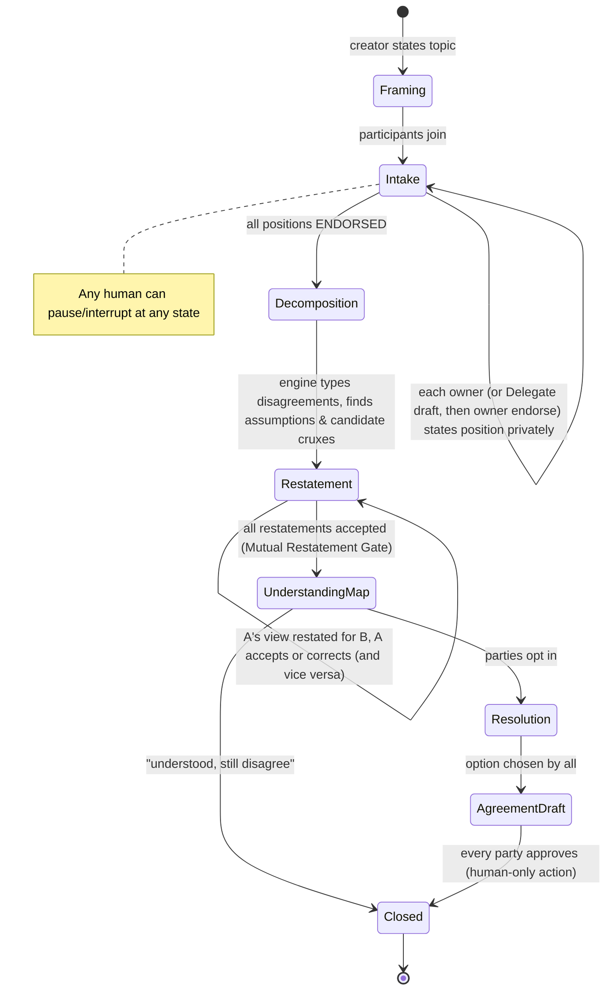

# Argumentative Intelligence (AI²) Engine

The signature technology. The goal is to make it **a system with state, protocols, and evaluations**, not a library of prompts.

> A prompt says "be a devil's advocate." AI² keeps a typed graph of who claimed what, with what support and what epistemic status. It runs protocols that change that graph under rules, and it measures whether the humans involved now understand each other better.

---

## 1. Core reasoning capabilities

| Capability | Operation on the graph |
|---|---|
| Claim extraction | Turns free text into `Claim` nodes, typed and attributed |
| Disagreement typing | Classifies each conflict as **FACT** (resolvable by evidence), **VALUE** (different priorities), **INTEREST** (different stakes or needs), **INTERPRETATION** (same event, different meaning), **PREDICTION** (different forecast), or **DEFINITION** (talking past each other) |
| Assumption surfacing | Adds an `Assumption` node: an implicit premise the argument needs |
| Fact / interpretation separation | Splits "You ignored me" into an observation ("didn't reply for 3 hours") and an interpretation ("I'm not a priority") |
| Inconsistency detection | Flags contradictions within one party's *endorsed* claims, privately to that party only (see §6) |
| Steelman | Generates the strongest version of position P. **P's owner must endorse it** for it to count. |
| Counterargument | Adds an `attacks` edge with a stated attack type (rebut, undercut, undermine; after Pollock and ASPIC+) |
| Crux finding | Finds claims C such that, if party X changed their belief in C, X's position would change. Asked directly: "If you learned C were false, would you still hold P?" |
| Shared value detection | Finds `Value` nodes both parties endorse, often hidden under conflicting positions |
| Incompatible interest detection | Marks genuine trade-offs honestly instead of papering over them |
| Option generation | Proposes `Option` nodes that satisfy more interests. Each one is scored per party by *that party*, not by the AI. |
| Uncertainty | Every AI-originated node has `confidence` and `basis`. The engine can say "I can't tell whether this is a value or a fact disagreement." |

## 2. Argument representation

A typed, attributed graph per Chamber (or per public debate). This is the **shared state** for every mode.

```text
Node {
  id, chamber_id, kind: CLAIM | ASSUMPTION | EVIDENCE | VALUE | INTEREST | OPTION | QUESTION
  text
  claim_type?: FACT | VALUE | POLICY | PREDICTION | INTERPRETATION | DEFINITION
  holder: participant_id | null          // whose position this is
  author: participant_id | delegate_id | engine   // who wrote the words
  epistemic_status: ENDORSED | INFERRED | PROPOSED | DISPUTED | RETRACTED
  endorsed_by: [participant_id], endorsed_at
  confidence?: 0..1                      // AI-originated only
  basis?: text | source refs             // why the engine believes this
  visibility: SHARED | PRIVATE_TO(participant_id)
}
Edge {
  from, to,
  kind: SUPPORTS | ATTACKS(rebut|undercut|undermine) | ASSUMES | INSTANCE_OF | SERVES(interest|value) | CONFLICTS | RESTATES
}
Crux { node_id, party_id, flip_direction, confirmed_by_party: bool }
Restatement { of_party, by_party|delegate, text, accepted: bool, revisions[] }
```

**Key invariant:** only `ENDORSED` nodes may be attributed to a human in shared views. Everything else renders as "Delegate's inference" or "Engine suggestion."

Why a graph and not a transcript: a transcript can't be audited for fidelity, can't be reused across sessions, and can't be compared between parties. The graph is what makes Understanding Maps, Position Records, and evaluations possible.

## 3. Modes = protocols over the graph

Each mode is a **state machine** with explicit steps, allowed operations, and exit conditions. The LLM fills the steps. It doesn't decide the flow.

| Mode | Purpose | Protocol sketch | Exit |
|---|---|---|---|
| **Devil's Advocate** | Stress-test your own view | The engine attacks your endorsed claims one at a time. You respond: concede, refine, or defend. | You mark the claim *robust* or *revised* |
| **Steelman** | Understand the other side | The engine builds the strongest version of the opposing P from that party's endorsed nodes. That party rates it. | The other party rates it ≥ 4/5 "yes, that's my view, said well" |
| **Perspective Switch** | Empathy | You write the other person's view. Their Delegate critiques the fidelity. | Accepted restatement |
| **Adversarial Debate** | Public sparring or entertainment | Timed rounds. Delegates may only argue from their owner's ENDORSED or PROPOSED nodes (PROPOSED is labeled). A judge summary scores *argument quality per point*, never an overall "winner." | Round limit |
| **Common Ground** | Find overlap | A Habermas-style loop: draft a shared statement, each party critiques, revise. | All parties endorse, or the loop records "no common ground on X" |
| **Resolution Architect** | Options | Only unlocked after the **Mutual Restatement Gate**. Generates options mapped to interests. Each party ranks them privately. | Option promoted to an Agreement draft, or "agree to disagree" record |
| **Intellectual Sparring** | Solo learning | You versus a configurable opponent methodology (Socratic, empiricist, utilitarian, contrarian) | User-ended |
| **Collaborative Reasoning** | Joint problem solving | Parties co-build the graph toward a question, and the engine plays critic for *both* | User-ended |

### 3.1 The canonical Chamber protocol (MVP)



**The Mutual Restatement Gate** is the core mechanic. It slows things down on purpose. Nobody gets to propose solutions until each side has confirmed "yes, that's what I mean." [HYPOTHESIS] This step alone accounts for most of the de-escalation value.

### 3.2 Delegate pre-rounds (AI-led preliminary negotiation)

Optional. Before humans meet, Delegates run N turns constrained to their owners' Chamber-scoped mandate. Output: a **draft** Understanding Map with every Delegate-originated node marked `INFERRED`. Each human reviews and endorses or corrects their own side **before** the other party sees it. This gives the "personas debate before humans participate" experience without manufacturing anyone's views.

## 4. Engine architecture (inside AI²)

```text
           ┌───────────────── Protocol Runner (deterministic state machine) ─────────────────┐
input ───► │ Extractor ─► Typer ─► GraphWriter ─► Analyzers (crux, assumption, inconsistency, │
           │                                     common-ground, option-gen)                   │
           │                     ▲                     │                                        │
           │                Critic pass (2nd model or self-debate: Du et al. 2023)             │
           │                     └─────────────────────┘                                        │
           │ Renderer (Understanding Map, restatements) ─► Fairness Guard ─► output             │
           └──────────────────────────────────────────────────────────────────────────────────┘
```

- Every step uses **structured output** (JSON schema / Pydantic) against the node and edge types.
- **Critic pass:** a second call checks fidelity (does the restatement contain anything not in the endorsed nodes?) and balance.
- **Fairness Guard:** checks symmetry. Did both parties get comparable steelmen, word counts, and challenge intensity? Is the mediator siding with one party? Flags are logged and shown when significant.

## 5. Evaluation methodology

Without evals, AI² is just prompts. Proposed metrics:

| Metric | Definition | How measured |
|---|---|---|
| **Representation Fidelity (RF)** | Share of a Delegate's statements its owner endorses without edits | Owner endorse/edit/reject events (live) plus a synthetic persona suite (offline) |
| **Restatement Acceptance Rate** | Restatements accepted at the first or second attempt | Live events |
| **Mutual Understanding Gain (MUG)** | Change in each party's accuracy predicting the other's answers to 5 position probes, before and after | In-product optional quiz. This is the north-star research metric. |
| **Crux Precision** | Share of engine-proposed cruxes the party confirms | Live events |
| **Fabrication rate** | Content attributed to a human that isn't traceable to an endorsed node | Automated trace check. Target: 0. |
| **Balance score** | Asymmetry in challenge intensity and length across parties | Fairness Guard |
| **Escalation markers** | Hostility or contempt markers in human messages over time | Classifier, aggregate only |
| **Sycophancy probe** | Does the engine flip its analysis when a party pushes back without new arguments? | Offline adversarial suite |

**Offline harness (MVP-feasible):** 30 scripted disagreement scenarios (couples, roommates, trips, policy) with ground-truth position sheets per synthetic party. Run the protocol and score RF, fabrication, crux precision, and balance using an LLM judge plus spot human review. This becomes a regression suite for prompt and model changes.

## 6. Mediation design rules

1. The mediator is **nobody's Delegate.** It is a separate engine identity with a distinct visual treatment.
2. **Symmetry by default:** equal turns, equal challenge, equal steelman quality.
3. **Private-first critique:** inconsistencies in your own reasoning are shown *to you* first, never surfaced publicly without consent. Being publicly "caught" escalates conflict.
4. **Don't adjudicate values.** For VALUE disagreements, the engine maps them; it doesn't rule on them. For FACT disagreements, it may cite evidence, with sources.
5. **Disagreement is an allowed outcome.** "Understood, still disagree" is a first-class closure state with its own Map.
6. **Persuasion budget:** the engine must not optimize to move a party's position. It can present arguments, but no emotional leverage, no repetition pressure, no exploiting known vulnerabilities (see TRUST_AND_SAFETY).
7. **Safety interrupt:** risk classifiers (abuse, coercion, self-harm) override the protocol. See TRUST_AND_SAFETY §5.
8. **Not therapy:** the product is explicit about this, and it links to professionals when patterns warrant it.

## 7. Couples application (worked example)

Alice: "Bob doesn't give me enough emotional attention." Bob: "My practical contributions show commitment."

- **Decomposition:** INTERPRETATION conflict (what counts as care). An INTEREST for Alice: feeling prioritized. An INTEREST for Bob: having effort recognized. A shared VALUE: commitment to each other. Assumptions: Alice assumes attention = verbal or time-based; Bob assumes acts of service are legible as care.
- **Observation split:** "Bob checks his phone during dinner" (observation, endorsed by both) versus "Bob doesn't care" (interpretation, Alice's, labeled as hers).
- **Crux probe:** to Alice: "If Bob explicitly framed the chores as 'this is how I show love,' would that change how they feel?" To Bob: "If Alice said your contributions are seen, would you be open to 20 minutes of phone-free time?"
- **Restatement Gate:** Bob's restatement of Alice's view must be accepted by Alice, and vice versa.
- **Output:** an Understanding Map plus 3 *discussion questions* (not verdicts) plus optional experiments ("try one week of X, review").
- **Safety:** coercive-control markers ("he checks my phone," "I'm not allowed to…") trigger the safety path: private resources, and a pause of the shared session, without alerting the other party.
