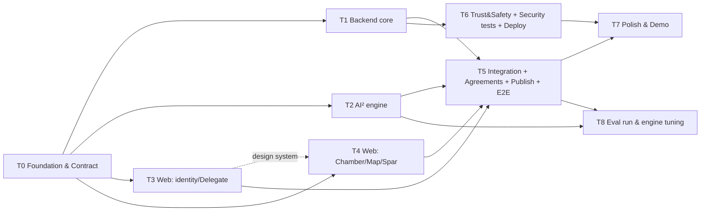

# Claude Code Cloud Execution Plan

## 0. Accepted decisions (2026-10-31; full log in OPEN_QUESTIONS.md §1)

Every session must respect these:
- Launch focus: small-group decisions and disagreements. No couple template (D5, D6).
- Names: **Delegate** / **Mediator** / `.d` handles (D14).
- Guests can join without a Delegate (D19). Autonomy is L0/L1 only (D20). One Delegate per human, 18+ (D11, D12).
- Models: Haiku 5.5 for extract, Sonnet 5.5 for analyze, a non-Anthropic critic (D16).
- Hosting: local Compose, then free tiers only (D15).
- Published Maps are anonymized by default (D17). Retention is 90 days after close (D21).
- Restate each party to the group once (D22). Pre-round only if on track at H48 (D23). No expenses in the MVP (D24).

## 1. Credit budgeting principles

- **[ASSUMPTION]** Credit consumption scales with tokens processed (context size × turns) and model choice, not with the number of sessions. "93 credits" isn't 93 sessions or N hours. **Measure early:** check the balance after T0 and recalibrate.
- Budget in **percentages**, with a hard reserve:

| Bucket | % of credits | Notes |
|---|---|---|
| T0 Foundation | 12% | Single session, high leverage |
| Wave 2 (T1–T4) | 40% | ~10% each |
| Wave 3 (T5–T6) | 20% | Integration is token-heavy (reading many files) |
| Wave 4 (T7–T8) | 13% | |
| **Reserve** | **15%** | Fixes, reruns, the demo-day emergency |

- **Credit hygiene:**
  - Each task prompt is self-contained and points to specific docs, so sessions don't read the entire repo.
  - Keep `CLAUDE.md` short (repo map, commands, invariants).
  - Each task ends by writing `docs/handoff/T#.md` (≤ 40 lines: what was built, how to run it, known gaps), so later sessions read the handoff instead of the code.
  - Use fake-LLM fixtures in tests. Don't burn model API calls in CI.
  - Stop a session that's looping. Re-scope it instead of letting it continue.
  - If a session is ≥ 60% through its bucket and not near its acceptance criteria, cut scope to the Must items in its list.

## 2. Repository layout (owned boundaries)

```text
/CLAUDE.md                     T0 (all may append to "Invariants" via PR)
/docker-compose.yml, /infra/   T0, later T6
/packages/contracts/           T0 owns. T1 regenerates. Others read-only.
  openapi.json, ts/ (generated client + types)
/services/api/                 FastAPI
  app/main.py, app/core/       T0
  app/modules/identity|delegates|memory|chambers|social|agreements|publications|notifications/   T1
  app/modules/safety/          T6
  app/engine/                  T2 (pure library: no FastAPI imports)
  app/workers/                 T5
  migrations/                  T0 creates. T1 owns afterwards.
  tests/                       per module owner
/evals/                        T2 (scenarios, harness), T8 runs
/apps/web/                     Next.js 16
  app/(auth)/, app/onboarding/, app/me/          T3
  app/chambers/, app/spar/, app/m/[slug]/        T4
  components/ui/ (design system)                 T3 owns. T4 may add components in components/chamber/
  lib/api/ (generated client wrapper, mocks)      T0, then T3
/e2e/                          T5 (Playwright)
/docs/                         planning docs (this package) + handoff/
```

**Rule:** a task modifies only the paths it owns. Changes needed elsewhere go into its handoff note as a "Request" for the owner, or the owner's integration task.

## 3. Dependency graph



T4 starts at the same time as T3, using unstyled primitives. On the first day, T3 must push `components/ui/` primitives within its first hour of work (a token file plus Badge, Button, Card, EpistemicTag, DelegateBadge).

## 4. Branching & integration

- Each task runs on branch `task/T#-slug` and opens a PR into `main`.
- Merge order: T0 → (T1, T2, T3, T4 in any order as they go green) → T5 → T6 → T7/T8.
- CI (set up in T0): `ruff` + `pytest` for the API, `tsc --noEmit` + `eslint` + `vitest` for web, and an OpenAPI drift check (the regenerated contract must equal the committed one).
- The founder reviews each PR's handoff note plus a CI check. Don't line-review generated code under time pressure. Review **invariants** (§6).

## 5. Task assignments

Each block below is a **ready-to-paste prompt** for a Claude Code Cloud session.

---

### T0: Foundation & contract (Wave 1, critical path)

**Objective:** a runnable monorepo skeleton with a *frozen v0 API contract*, so four sessions can work in parallel.

**Read first:** `docs/SYSTEM_ARCHITECTURE.md` §1, §3–§7; `docs/PERSONA_ARCHITECTURE.md` §1–2; `docs/UX_PRODUCT_SPEC.md` §3.

**Build:**
1. Monorepo per the layout in §2. Use `pnpm` for web and `uv` for Python.
2. `docker-compose.yml`: postgres:16 with pgvector, redis:7, api, worker (placeholder), web.
3. FastAPI app with Pydantic models for **every MVP endpoint** in SYSTEM_ARCHITECTURE §5 (✔ rows). Handlers return deterministic **fixture data** from `app/fixtures/`. Include the SSE endpoint emitting a fixture event sequence.
4. SQLAlchemy 2 models plus an Alembic migration for every table in §4, including `epistemic_status`, `scope_type/scope_id`, and `chamber_events`.
5. Export the OpenAPI to `packages/contracts/openapi.json`. Generate TS types with `openapi-typescript` into `packages/contracts/ts/`. Add a `make contracts` script.
6. Next.js 16 (App Router, React 19, Tailwind 4) shell: the tokens from the UX spec §7, fonts via `next/font`, the 4-tab mobile nav and desktop rail, and placeholder routes for all screens. A typed API client in `apps/web/lib/api/` with a `NEXT_PUBLIC_API_MODE=stub|live` switch.
7. `CLAUDE.md`: repo map, commands, the **Invariants** list (§6), and the **Accepted decisions** summary (§0).
8. CI workflow (GitHub Actions) as in §4.

**Acceptance:** `docker compose up` → API `/docs` lists every endpoint. `/chambers/{id}/stream` streams fixture events. Web shows the shell at `localhost:3000`. CI passes. Contract committed.
**Tests:** a pytest smoke test per router (status code plus schema validation). A vitest smoke render.
**Deliverables:** PR plus `docs/handoff/T0.md`.

---

### T1: Backend core (Wave 2)

**Objective:** replace fixtures with real persistence and permissions for identity, Delegates, memory, Chambers, invites, the protocol state machine (excluding engine calls), pause, events, and SSE.

**Owns:** `services/api/app/modules/{identity,delegates,memory,chambers,social,agreements,publications,notifications}`, `migrations/`, `packages/contracts/` regeneration.
**Depends on:** T0 merged.
**Read:** SYSTEM_ARCHITECTURE §4–§8, PERSONA_ARCHITECTURE §2, §4, §5, ARGUMENTATIVE_INTELLIGENCE §3.1.

**Build:**
- Magic-link auth (log the link to the console in dev) plus `DEV_LOGIN=1` bypass. JWT sessions with an `actor_type` claim (`human` for interactive sessions, `service` for workers).
- **Guest participants** (D19): `memberships.delegate_id` nullable. A guest submits positions as a human, then is offered Delegate creation. Autonomy limited to L0/L1 (D20). Chamber retention job: purge 90 days after close unless extended (D21).
- Delegate CRUD. Unique `.d` handles. A position-cards catalog (seed 3 templates × 8 cards in a YAML file).
- Positions CRUD with scope. Postgres **RLS** policies on `positions`, `nodes`, `episodes`. A `scoped_positions(delegate_id, context)` repository function, which is the *only* retrieval path.
- Chambers: templates, invites (tokenized), membership, and a **protocol state machine** (`Framing → Intake → Decomposition → Restatement → Map → Resolution → Closed`) with server-side gate checks. Engine steps call an `EngineGateway` **interface** (with a stub implementation) that T5 will wire up.
- Pause/resume (sets state, emits an event, and marks in-flight runs `cancel_requested`).
- `chamber_events` append plus Redis publish. SSE filters by visibility.
- Agreements: text items plus approvals. Approvals require `actor_type=human`.
- Publications: a consent table. Publish only when all members consent. Revocation unpublishes.

**Acceptance:** all endpoints are backed by the DB. The contract is unchanged, or regenerated with additive changes only (noted in the handoff).
**Tests (required):** gate enforcement (AC4). Scope isolation across Chambers (AC5). Human-only approval and endorsement (AC8, service token → 403). Pause event within 2 s (integration). Publish consent.
**Deliverables:** PR plus `docs/handoff/T1.md`.

---

### T2: Argumentative Intelligence engine (Wave 2)

**Objective:** a pure-Python library implementing AI² operations with structured outputs, a model router, and an eval harness.

**Owns:** `services/api/app/engine/`, `evals/`.
**Depends on:** T0 (only for the Pydantic node/edge types, which it can define locally and reconcile in the handoff).
**Read:** ARGUMENTATIVE_INTELLIGENCE.md (all), PERSONA_ARCHITECTURE §2.

**Build:**
- `ModelRouter` with task classes `extract|analyze|critic|moderate|embed`. Providers via env vars (Anthropic, OpenAI, Google adapters plus `FakeProvider` with recorded fixtures). **Defaults (D16):** `extract`=`claude-haiku-5-5`, `analyze`=`claude-sonnet-5-5`, `critic`=Gemini or OpenAI via `CRITIC_PROVIDER`/`CRITIC_MODEL` env. Implement the Anthropic adapter plus one critic adapter fully. For groups of >2, `restate` produces one restatement per party addressed to the whole group (D22).
- Operations (each a function taking typed input and returning typed output, validated, with retry-on-invalid ×2):
  `decompose(positions) -> Graph(nodes, edges, cruxes)`, `restate(party_positions, audience) -> Restatement`, `revise_restatement(prev, feedback)`, `render_map(graph, restatements) -> UnderstandingMap`, `spar_turn(claim, history, mode, methodology) -> SparTurn`, `robustness_report(history)`, `draft_position(delegate_profile, endorsed_positions, chamber_topic) -> Draft(INFERRED)`, `critic(output, sources) -> CriticReport(fidelity_violations, balance)`.
- **Fabrication guard:** every human-attributed sentence in a Map or restatement carries `source_node_ids`. A post-check rejects outputs that cite non-endorsed nodes.
- Prompts live in `engine/prompts/*.md` with versioned headers.
- `evals/`: 10 scenarios (YAML: parties, ground-truth positions, expected disagreement types, cruxes). The harness runs the protocol end-to-end and outputs JSON plus Markdown with RF proxy, fabrication count, crux precision, balance, and cost.

**Acceptance:** unit tests pass with `FakeProvider`. A live run on 5 scenarios yields fabrication = 0, all outputs schema-valid, and per-Map cost reported.
**Tests:** schema validation, fabrication guard (negative test), retry path, router fallback.
**Deliverables:** PR, `evals/REPORT.md` from the live run, `docs/handoff/T2.md` (including the exact engine API for T5).

---

### T3: Web, identity, Delegate & design system (Wave 2)

**Objective:** the design system plus onboarding, Delegate creation, Memory Inspector, and Me.

**Owns:** `apps/web/components/ui/`, `apps/web/app/{(auth),onboarding,me}/`, `apps/web/lib/api/`.
**Depends on:** T0. Runs against `API_MODE=stub`.
**Read:** UX_PRODUCT_SPEC.md (all), PERSONA_ARCHITECTURE §1–§5, PRD F1.x.

**Build (in this order; push primitives within the first commit):**
1. Tokens and primitives: Button, Card, Badge, **DelegateBadge**, **EpistemicTag**, Glyph (deterministic SVG from a seed), Avatar (human circle vs Delegate rounded square), PauseButton, EngineThinking, StateRail, Sheet/Modal.
2. Login (magic link plus dev login).
3. Onboarding: 3-step Delegate creation with swipe/keyboard position cards. End screen: "Your Delegate knows N things."
4. Memory Inspector: list, edit, retract, scope chips, history drawer.
5. Me / Settings: autonomy default, pause Delegate, export (JSON download), delete account (with confirmation).

**Acceptance:** keyboard and screen-reader accessible. Mobile (375px) and desktop layouts. Every Delegate-rendering component includes DelegateBadge (enforce it with an ESLint rule or a test helper).
**Tests:** vitest plus Testing Library for primitives and the onboarding flow. axe checks.
**Deliverables:** PR, a screenshot set in `docs/handoff/T3/`, `docs/handoff/T3.md`.

---

### T4: Web, Chamber, Understanding Map, Spar (Wave 2)

**Objective:** the core experience screens against stubs.

**Owns:** `apps/web/app/{chambers,spar,m}/`, `apps/web/components/chamber/`.
**Depends on:** T0. Uses T3's primitives when they land; before that, use local temporary components and swap them later.
**Read:** UX_PRODUCT_SPEC §3–§5, ARGUMENTATIVE_INTELLIGENCE §3, PRD J1–J3.

**Build:** Chamber create (template picker), invite share sheet (copy link plus a WhatsApp/iMessage intent), join flow, Brief with StateRail, private intake composer with "Draft with my Delegate" → endorse/edit, Restatement cards (accept / not quite plus feedback), **Understanding Map** editorial page (sections per UX §4.5, disagreement-type chips, crux markers), Options/Agreement with ApprovalRows, Spar (claim, mode/methodology select, rounds, robustness report), public Map page `/m/[slug]` (server-rendered, OG metadata), SSE hook `useChamberStream`.

**Acceptance:** the full J1 flow is clickable with stub data. The Map page is beautiful on mobile and desktop. Pause is visible on every Chamber screen.
**Tests:** component tests for RestatementCard, ApprovalRow (never pre-checked), Map rendering (only ENDORSED content attributed to humans in the fixture), and the SSE hook.
**Deliverables:** PR, screenshots, `docs/handoff/T4.md`.

---

### T5: Integration, workers, E2E (Wave 3)

**Objective:** the real end-to-end product.

**Owns:** `services/api/app/workers/`, the `EngineGateway` implementation, `/e2e/`, glue fixes in web `lib/api` (coordinate via the handoff).
**Depends on:** T1, T2, T3, T4 merged.
**Read:** all `docs/handoff/T1–T4.md`, SYSTEM_ARCHITECTURE §8.

**Build:** arq worker running engine jobs (decompose, restate, revise, map, spar, draft) with idempotency (`run_id`, input hash), cancellation on pause, a 90 s timeout, progress events. Switch web to `API_MODE=live`. Seed script: 2 demo users, a pre-run Chamber, a published Map. Playwright E2E with **FakeProvider**: J1 (3 browser contexts), J3, and the pause test. A smoke run with a live provider.

**Acceptance:** E2E green in CI (fake). Manual live run completes J1 in under 15 minutes.
**Deliverables:** PR plus `docs/handoff/T5.md` with a demo script.

---

### T6: Trust & Safety, security tests, deployment (Wave 3, parallel with T5)

**Owns:** `services/api/app/modules/safety/`, `/infra/`, deployment config, security tests in `services/api/tests/security/`.
**Depends on:** T1 (merged). Coordinates with T5 on hook points (`safety.check_input`, `safety.check_output`).
**Read:** TRUST_AND_SAFETY.md (all).

**Build:** input/output moderation (provider endpoint plus a rules layer: impersonation grammar, out-of-scope position leakage, personal attacks). `safety_flags` with private-to-user visibility. Report endpoint. Audit log for admin reads. Rate limits (invites, engine runs per user per hour). An 18+ attestation at signup. Deploy (D15): free tiers only. Vercel (web), Render or Fly (api and worker), Neon (Postgres plus pgvector), Upstash (Redis). Fallback: a documented single-VM Compose deploy. **Never provision anything paid. If an account or key is missing, write the runbook and stop.** Publications are anonymized by default (D17): enforce in the publish renderer.

**Tests:** prompt-injection suite (10 adversarial participant messages trying to extract another Chamber's positions → 0 leaks). Impersonation output test. AC3/AC5/AC8 re-verified end-to-end.
**Deliverables:** PR, `docs/handoff/T6.md`, a deployed URL or deploy runbook.

---

### T7: Polish & demo (Wave 4)
Empty states, copy pass (tone: calm, editorial), mobile QA, OG image generation for Maps, loading choreography for EngineThinking, Lighthouse fixes, README with a demo GIF. **Acceptance:** MVP_ROADMAP §4 criteria 1, 4, 5.

### T8: Eval run & engine tuning (Wave 4)
Run all 10 scenarios live, fix prompts, record before/after in `evals/REPORT.md`. Optional C1 Delegate pre-round if the metrics pass. **Acceptance:** MVP_ROADMAP §4 criterion 3.

## 6. Invariants (copy into CLAUDE.md; reviewers check these on every PR)

1. Only `actor_type=human` interactive sessions can endorse positions, accept restatements of themselves, approve agreement items, or consent to publication.
2. Delegate and engine retrieval goes only through `scoped_positions()`. Never query `positions` directly in engine paths.
3. Human-attributed text in shared views must reference ENDORSED node IDs.
4. Every rendered Delegate message includes `DelegateBadge` plus `EpistemicTag`.
5. No resolution or options before the Restatement Gate passes (server-enforced).
6. Pause halts runs and blocks new runs.
7. No model API keys in the web app. No real LLM calls in CI.

## 7. Session-operating tips

- Start each session with: "Read CLAUDE.md, then the docs listed in your task. Do not read other modules."
- Ask sessions to commit early and often on their task branch, so a dropped container doesn't lose work.
- If two sessions need the same contract change, the change goes through T1. Others note it in their handoff.
