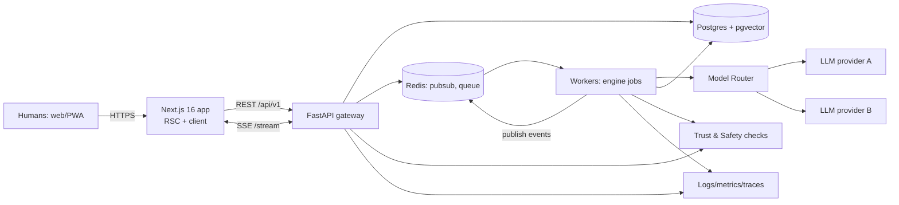
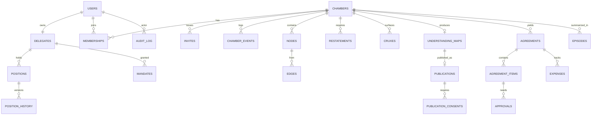
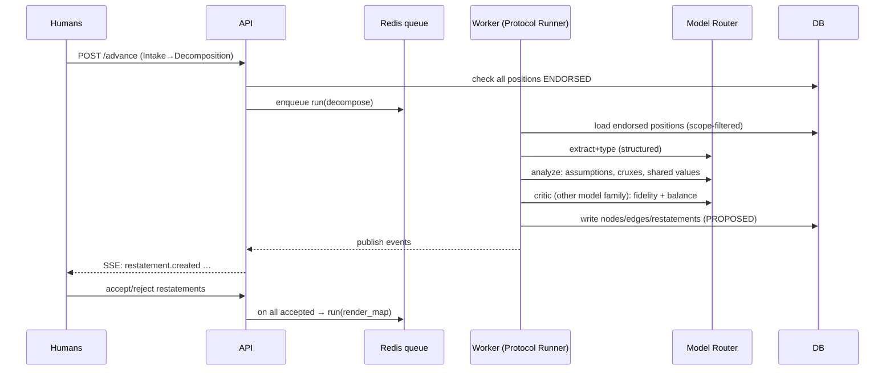

# System Architecture

There are two horizons: an **MVP architecture** that can be built in 72 hours, and a **v1+ architecture** designed so the MVP doesn't need rewriting to get there.

---

## 1. Stack evaluation

| Layer | Proposed | Verdict | Rationale / alternative |
|---|---|---|---|
| Frontend | Next.js 16 + React 19 + Tailwind 4 | **Accept** | **[FACT]** Next.js 16 went stable Oct 21, 2025, with Turbopack as the default and Cache Components (`"use cache"`) ([nextjs.org](https://nextjs.org/blog/next-16)). Note that `middleware.ts` is renamed to `proxy.ts`, and later 16.x security releases exist, so pin the latest 16.x. |
| PWA | — | **Accept (v1)** | Manifest plus push in v1. Native apps (Expo) only after retention is proven. |
| Backend | FastAPI | **Accept, with reasoning** | A single TS stack would be faster for one dev. But (a) the AI orchestration and eval harness are better served in Python, and (b) **an OpenAPI contract between a Next app and a FastAPI service is a clean seam for parallel Claude Code tasks.** That second point decides it. |
| DB | PostgreSQL 16 + pgvector | **Accept** | One store for relational data, graph data (nodes and edges tables), and embeddings. Avoid a separate vector DB or graph DB until there's scale evidence. |
| Cache/queue | Redis | **Accept** | Pub/sub for realtime fan-out, plus the job queue (arq or RQ). |
| Realtime | WebSockets | **Modify → SSE for MVP** | Clients mostly *receive* streamed engine output and state changes. SSE through FastAPI is simpler and works over plain HTTP. Writes go over REST. Move to WS when there's live co-presence typing. |
| Workers | Background workers | **Accept** | arq (async, Redis-backed). Engine runs are jobs, never on the request thread. |
| Orchestration | LangGraph | **Defer** | The Chamber protocol is a **deterministic state machine** owned by our code. LangGraph adds a dependency and hides the state we need to audit. Use plain Python state machines plus a thin LLM client. Revisit for long-running agent loops in v1. |
| Models | Gemini / Claude / OpenAI / OSS | **Router** | A `ModelRouter` with task classes: `extract` (fast, cheap), `analyze` (strong reasoning), `critic` (a *different family* from analyze, which reduces correlated errors), `moderate`, `embed`. Configured by env. **Decided (D16):** `extract` = `claude-haiku-5-5`, `analyze` = `claude-sonnet-5-5` (`render_map` may move to `claude-opus-5-5` if evals justify it), `critic` = a Gemini or OpenAI model. |
| Structured gen | — | **Required** | Every engine call returns JSON validated by Pydantic, with retry-on-invalid (max 2). |
| Auth | — | **Auth.js (NextAuth) email magic link → FastAPI JWT** | Or Clerk/Supabase Auth to save time. MVP: magic link plus a dev-login bypass behind a flag. |

## 2. System context



## 3. Components (logical services; one deployable FastAPI app with modules in the MVP)

| # | Component | Responsibility | Key tables | MVP? |
|---|---|---|---|---|
| 1 | **Identity** | Users, sessions, verification level, account deletion | `users`, `sessions` | ✔ |
| 2 | **Persona engine** | Delegate CRUD, voice/methodology, mandate issuance and check | `delegates`, `mandates` | ✔ |
| 3 | **Persona memory** | Positions, episodic summaries, scoped retrieval, Memory Inspector API | `positions`, `position_history`, `episodes`, `embeddings` | ✔ |
| 4 | **Social graph** | Contacts, follows, Chamber membership, invitations | `memberships`, `invites`, `follows` | membership/invites ✔ |
| 5 | **Content engine** | Public Maps, profiles, topics, feed assembly | `publications`, `publication_consents` | lite ✔ |
| 6 | **Debate orchestration** | Protocol state machines, turn-taking, timers, pause/interrupt | `chambers`, `chamber_events`, `runs` | ✔ |
| 7 | **AI² engine** | Extract, type, analyze, restate, crux, critic, render | `nodes`, `edges`, `cruxes`, `restatements` | ✔ |
| 8 | **Mediation engine** | Mediator identity, symmetry/Fairness Guard, safety routing | (uses 6/7) | basic ✔ |
| 9 | **Agreement engine** | Drafts, items, per-party approvals, expenses, settlement | `agreements`, `agreement_items`, `approvals`, `expenses`, `splits` | text items ✔ |
| 10 | **Notification** | In-app plus email: invites, "your turn," approvals | `notifications` | in-app ✔ |
| 11 | **Trust & Safety** | Input/output moderation, risk classifiers, rate limits, reports, audit | `reports`, `safety_flags`, `audit_log` | core ✔ |
| 12 | **Analytics/observability** | Product events, engine traces, eval metrics, cost per run | `events` (or PostHog), OTel | basic ✔ |

## 4. Data model (ERD)



Core columns (abridged):

```text
users(id, email, display_name, verified_level, created_at, deleted_at)
delegates(id, owner_id UNIQUE, handle UNIQUE, name, glyph_seed, voice jsonb, methodology, status)
positions(id, delegate_id, statement, topic_tags text[], status, scope_type, scope_id, is_boundary, source, created_at)
chambers(id, creator_id, template, title, state, paused_by, created_at, closed_state)
memberships(chamber_id, user_id, role[creator|participant|observer], autonomy, joined_at)
nodes(id, chamber_id, kind, claim_type, text, holder_id, author_type, author_id, epistemic_status, confidence, basis, visibility, visible_to)
edges(id, chamber_id, from_id, to_id, kind, attack_type)
restatements(id, chamber_id, of_user_id, text, status[pending|accepted|rejected], revision, feedback)
cruxes(id, chamber_id, node_id, party_id, confirmed bool)
understanding_maps(id, chamber_id, version, content jsonb, created_at)
agreements(id, chamber_id, status[draft|pending|approved|void], created_by)
agreement_items(id, agreement_id, kind[text|expense|responsibility], body jsonb, proposed_by_type[human|engine])
approvals(item_id, user_id, decision[approve|reject], decided_at)   -- only writable by an authenticated human session
chamber_events(id, chamber_id, seq, type, actor_type, actor_id, payload jsonb, created_at)   -- append-only
audit_log(id, actor_id, action, target, metadata, at)
```

## 5. API contracts (v1 REST, abridged; the MVP implements the ✔ rows)

| Method | Path | Purpose | ✔ |
|---|---|---|---|
| POST | `/auth/magic-link` · `/auth/verify` | Login | ✔ |
| GET/PATCH | `/me` · DELETE `/me` | Profile / delete account | ✔ |
| POST | `/delegates` | Create own Delegate | ✔ |
| GET/PATCH | `/delegates/me` · GET `/delegates/{handle}` | Own / public profile | ✔ |
| GET/POST/PATCH/DELETE | `/delegates/me/positions[/{id}]` | Memory Inspector | ✔ |
| GET | `/position-cards?template=` | Onboarding cards | ✔ |
| POST | `/chambers` | Create from template | ✔ |
| GET | `/chambers` · `/chambers/{id}` | List / detail (state, members, my tasks) | ✔ |
| POST | `/chambers/{id}/invites` · `/invites/{token}/accept` | Invite / join | ✔ |
| POST | `/chambers/{id}/positions` | Submit intake (draft or endorsed) | ✔ |
| POST | `/chambers/{id}/delegate-draft` | Ask own Delegate to draft intake | ✔ |
| POST | `/chambers/{id}/advance` | Request a protocol transition (server validates the gate) | ✔ |
| GET | `/chambers/{id}/graph` | Nodes and edges visible to the caller | ✔ |
| POST | `/restatements/{id}/accept` · `/reject` {feedback} | Gate loop | ✔ |
| POST | `/cruxes/{id}/confirm` | | ✔ |
| GET | `/chambers/{id}/map` | Understanding Map | ✔ |
| POST | `/chambers/{id}/pause` · `/resume` | Human interrupt | ✔ |
| POST | `/chambers/{id}/agreements` · `/agreement-items/{id}/approve` | Agreements | ✔ |
| POST | `/spar` · `/spar/{id}/turn` | Solo sparring | ✔ |
| POST | `/chambers/{id}/publish` · `/publications/{id}/consent` | Publish Map | ✔ |
| GET | `/public/maps` · `/public/maps/{slug}` | Public layer | ✔ |
| GET | `/chambers/{id}/stream` (SSE) | Events | ✔ |
| POST | `/reports` | Report content or user | ✔ |

Error shape: `{"error": {"code": "GATE_NOT_SATISFIED", "message": "...", "details": {...}}}`. The OpenAPI spec is the source of truth and is generated by FastAPI into `packages/contracts/openapi.json`. TS types are generated with `openapi-typescript`.

## 6. Event schemas

All state changes are appended to `chamber_events` and published to Redis channel `chamber:{id}`. The SSE stream relays the events the caller is allowed to see.

```json
{
  "id": "evt_01J…", "chamber_id": "chm_…", "seq": 42,
  "type": "restatement.created",
  "actor": {"type": "engine|human|delegate", "id": "…"},
  "visibility": {"scope": "shared"} ,
  "payload": {"restatement_id": "rst_…", "of_user_id": "usr_…"},
  "created_at": "2026-10-31T12:00:00Z", "schema_version": 1
}
```

Event types: `chamber.created`, `member.joined`, `position.submitted`, `position.endorsed`, `state.changed`, `engine.run.started|progress|completed|failed`, `node.created`, `restatement.created|accepted|rejected`, `crux.proposed|confirmed`, `map.generated`, `chamber.paused|resumed`, `agreement.item.proposed|approved|rejected`, `agreement.approved`, `safety.flag` (private to the affected user and T&S only), `publication.consent.granted|revoked`.

## 7. Permission model

Use RBAC per Chamber plus ABAC on visibility and scope. Enforce it in the service layer **and** with Postgres RLS for `positions`, `nodes`, and `episodes`.

| Actor | Can |
|---|---|
| Chamber creator | Invite, set template, close (not delete others' content) |
| Participant | Submit, endorse, accept/reject restatements of *self*, pause, approve agreement items, consent to publish |
| Observer [v1] | Read shared nodes only |
| Delegate (acting under a mandate) | Draft nodes (`epistemic_status ∈ mandate.may_assert`); never approve, consent, or endorse |
| Engine | Create PROPOSED/INFERRED nodes, restatements, cruxes, maps; never endorse, approve, or consent |
| T&S admin | Read flagged content per the documented policy, with an audit log entry per access |

**Hard rules in code:** `approvals`, `publication_consents`, and `endorse` endpoints require `actor_type == human` from an interactive session token. Worker or service tokens are rejected.

## 8. AI orchestration flow (Chamber decomposition)



Idempotency: each run has `run_id` and an input hash, so retries never duplicate nodes. Engine runs time out at 90 s, and the Chamber shows "retry."

## 9. Deployment architecture

- **Decided (D15):** Docker Compose locally during the 72h build, then free tiers. No paid infrastructure before real usage.
- **MVP hosted:** Vercel (Next.js) + Fly.io or Render (FastAPI API + worker as two processes) + managed Postgres (Neon or Supabase, with pgvector) + Upstash Redis. Docker Compose for local dev. **[ASSUMPTION]** The founder has accounts or can create them. Otherwise the MVP demo runs fully in Docker Compose.
- **v1:** Containerized services on a single cloud (GCP Cloud Run or AWS ECS), Postgres with read replicas, separate worker pools per model class, Redis cluster, object storage for exports, and a WAF.
- Secrets live in platform secret stores. Model keys are only on the API and worker, never on the frontend.

## 10. Scalability & trade-offs

| Concern | Approach | Trade-off |
|---|---|---|
| LLM cost per Chamber | Cheap model for extraction, strong model only for analysis and critic. Cache maps by graph hash. Budget cap per Chamber. | Quality versus cost. Track `$ per completed Map` as a key metric. |
| Latency | Async jobs plus streamed progress events. The UI is designed for "the engine is thinking" moments. | Not chat-instant. That's acceptable for a reflective product. |
| Graph in Postgres | Adjacency tables. Chamber graphs are small (< 500 nodes). | No graph DB needed. Public topic graphs at scale might need one later. |
| Fan-out | Chamber sizes are ≤ 12. Public maps are static, cacheable pages. | The public feed is not real-time, by design. |
| Multi-tenancy of memory | RLS plus scope predicates | Slight query complexity. Non-negotiable. |
| Monolith vs services | Modular monolith (one FastAPI app, 12 modules, clear interfaces) | Easy to split later along module seams |
